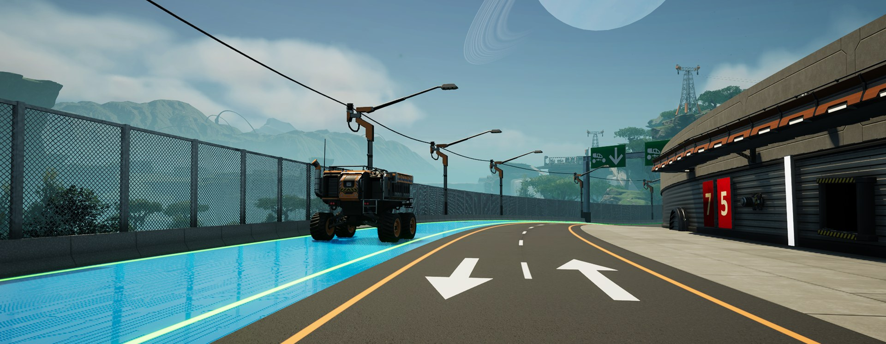
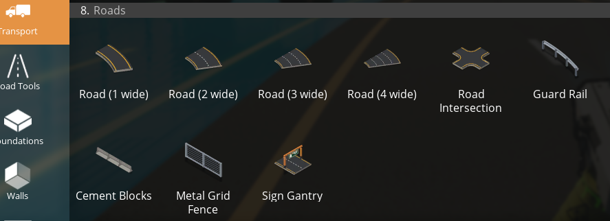
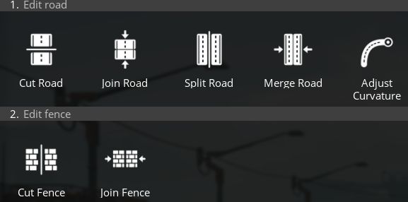

# Road Maker

A Satisfactory mod (C++, SML) that adds real roads: curved roads 1 to 4 foundations wide in asphalt,
concrete blocks or cyberpunk, lane lines and lane markings, intersections joining up to six roads,
tools to cut, split and reshape roads, road fences and fence walls, a sign gantry, and snapping for
the game's paths, tracks, poles, signs and foundations.

**Download / install:** [ficsit.app](https://ficsit.app/mod/RoadMaker) (use the Satisfactory Mod
Manager). Current version: **1.2.0**, for Satisfactory 1.2 with SML 3.12.

## Features

**Roads (build menu › Transport › Roads)**
- Road 1, 2, 3 and 4 wide: two clicks, curves drawn as quadratic Bezier curves; build modes Default,
  Straight and Smooth. Snap to road ends, intersection ends and foundation edges.
- Hold the snap key and aim at a built road (or an intersection curb) to build a road beside it in one click.
- Road Intersection: pick up to 6 free road ends, they are joined with curved curbs.
- Free to build; unlocks with the Road Maker milestone (Tier 1).

**Customizer**
- Road Lines tab: side lines on / off; 1 to 4 lanes, dashed or continuous (primary colour = middle
  lines, secondary = side lines).
- Road Lines › Markings: **Lane Arrow** (6 arrows) and **Lane Number** (0 to 9). Aim at a lane, the
  mouse wheel picks the variant, click paints. Sized to the lane, lying on the road surface, in the
  road's line colours (glowing on cyberpunk roads); they move along when a road is reshaped.
- Material tab › Roads: Asphalt, Concrete Blocks, Cyberpunk, switched in place.

**Road Tools (build menu tab)**

- Cut Road (optionally cutting its fences too), Split Road (lengthwise, in 8 m steps), Adjust
  Curvature (grab a road end and reshape it), Cut Fence.

**Fences, walls and signs**
- Guard Rail, Cement Blocks, Metal Grid Fence: follow a road edge or intersection curb.
- Fence walls (Walls › Fence Walls): FICSIT, Concrete, Steel and Steel Mesh, 4 m tall, stackable,
  painted and switched like the game's walls.
- Sign Gantry: the game's H-beams across a road, 8 to 24 m high; signs snap to it every 2 m.
- Signs and wall attachments (wall mounts, wall holes, ladders...) snap to fence walls and the gantry.

**Snapping for game buildings**
- One-click vehicle paths and railway tracks along a lane, and all connections through an
  intersection at once (snap key).
- Power poles and street lights snap to the fence lines; paths and tracks snap to road ends per lane;
  foundations, frames and ramps snap to road ends.

**Performance:** only a few numbers are saved per piece (meshes are rebuilt on load); distant pieces
switch to simpler meshes.

The full player description and the changelogs are in [`Tools/Release/ficsit-page.md`](Tools/Release/ficsit-page.md).

## Building from source

1. Set up the Satisfactory modding environment (docs.ficsit.app): the custom Unreal Engine, Visual
   Studio and the SML Starter Project.
2. Clone this repo into the starter project as `Mods/RoadMaker`.
3. Edit the paths at the top of [`Tools/update-and-package.bat`](Tools/update-and-package.bat) and run it. It:
   1. pulls the latest code;
   2. builds the editor;
   3. creates or updates every Blueprint asset with [`Tools/create_assets.py`](Tools/create_assets.py)
      (buildables, holograms, descriptors, recipes, the milestone, build menu and customizer entries,
      icons from `Tools/Icons`);
   4. builds the materials with [`Tools/make_materials.py`](Tools/make_materials.py);
   5. packages the mod into the game folder.

   It ends with ALL DONE, or FAILED with the details in `update-log.txt`.
4. Release zips: Alpakit Release, see [`Tools/Release/HOW-TO-RELEASE.md`](Tools/Release/HOW-TO-RELEASE.md).

No Blueprint is edited by hand: the Python scripts are the source of truth for the assets.

## Repository layout

| Path | What |
|---|---|
| `Source/RoadMaker/.../Buildables` | Road, fence, intersection, gantry and lane marking buildables (procedural meshes rebuilt from saved inputs) |
| `Source/RoadMaker/.../Holograms` | Placement for each buildable and the Road Tools |
| `Source/RoadMaker/.../Snapping` | Hooks that make the game's own holograms snap to roads, fence walls and the gantry |
| `Source/RoadMaker/.../Customization` | Road Lines tab, markings painting, road and fence wall materials in the customizer |
| `Source/RoadMaker/Private/RMGeometry.cpp` | Curves, road / fence / intersection mesh building |
| `Tools/` | Asset and material scripts, build script, icons (`Tools/IconSource` renders them) |
| `Tools/Release/` | Mod page text, changelog, release steps, logo |
| `docs/` | Roadmap, developer notes, screenshots |

## Roadmap

1.2.0 is out ([roadmap](docs/ROADMAP-1.2.0.md)). Planned for 1.3.0: traffic lights that follow the
intersection, a Join tool, proper build animations per piece, and a road preview on the map.

## License and credits

Made by [jollyeye](https://github.com/jollyeye). Multiplayer support is included but lightly tested;
please report issues on GitHub.
