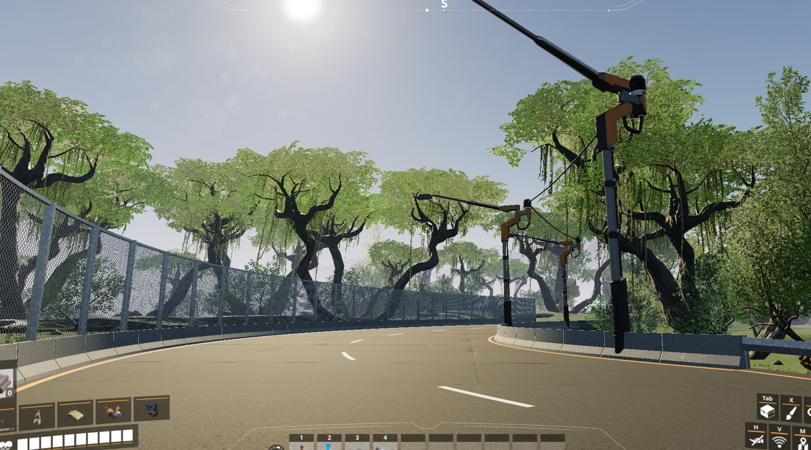

# Road Maker — ficsit.app page

## Name
Road Maker

## Mod reference (must be exactly this)
RoadMaker

## Short description (max 128 characters)
Curved roads 1–3 foundations wide with lane lines, road-edge fences, intersections, and snapping for paths, rails and poles.

## Full description (paste as Markdown)

**Road Maker** adds real roads to Satisfactory: curved asphalt roads with concrete sides, lane markings you set in the customizer, fences that follow the road edge, and intersections that join up to six roads.

Everything unlocks in the **Road Maker** milestone in Tier 1. Roads and intersections are **free to build**.

### Roads (1, 2 and 3 foundations wide)
- Two clicks: start and end. The road curves like a vehicle path; the mouse wheel turns it.
- Build modes: **Default**, **Straight**, and **Smooth** (height eases in and out to join roads at different levels without kinks, up to 45°).
- Snaps to the ends of other roads and intersections, and to foundation edges (top level with the foundation).
- 1 m thick, asphalt and concrete textures matched to the game's foundations.
- Other buildings can be placed on roads, just like on foundations.

### Lane lines — Customizer › Road Lines

- **Sidelines:** on / off.
- **Lanes:** 1 lane, 2 lanes dashed or continuous, 3 lanes dashed or continuous.
- Hover a road to preview, click to apply. Middle lines use the **primary colour**, side lines the **secondary colour**; roads have their own default swatch group ("Roads").

### Road Intersection

- Click the free road ends (or free intersection ends) you want to join, up to 6, then click away from them to build: they are joined with curved curbs. The aimed end is outlined in orange, picked ends in white with an arrow.
- Free ends are capped and can be built on again; intersections can join each other.
- Side lines along the curbs (Road Lines › Sidelines).

### Fences
- **Guard Rail**, **Cement Blocks** (with block joints), **Metal Grid Fence** and **Metal Grid Fence (4m tall)**.
- Aim at a road: the fence follows the whole edge on the side you look at, facing the road. On an intersection it follows the curb.
- Free placement anywhere, snapping to the foundation grid.

### Concrete Fence Wall — Walls › Fence Walls
- A 4 m tall, 0.5 m thick concrete wall centred on the road edge (or an intersection's curb), following it like the fences.
- Aim at the upper or lower half of a fence wall to stack another one above or below it.
- Uses the game's own wall materials: paints exactly like the game's walls, and the customizer's Material tab switches it between concrete, FICSIT and steel.
- Unlocked with the Tier 1 **Base Building** milestone.

### Snapping for game buildings
- **Power poles** (all tiers) and **street lights** snap to the road's fence lines while holding the snap key (Ctrl); street lights face the road, scroll flips them.
- **Vehicle paths** and **railway tracks** snap to road and intersection ends — one point per lane (every 2 m on 1-lane roads) — and line up with the road, slope included; scroll flips them 180°.

### Performance
- Far-away roads, intersections and fences switch to simpler meshes.
- Saves stay small: only a few numbers per piece are saved, meshes are rebuilt on load.

### Notes
- Multiplayer support is included but has not been tested yet — please report issues.
- Source code: https://github.com/jollyeye/Satisfactory-Road-Fence-Tool

## Changelog for version 1.1.0
- **New: Concrete Fence Wall** (Walls › Fence Walls, unlocked with Tier 1 Base Building): a 4 m wall along the road edge or an intersection curb, stackable, paintable, in concrete, FICSIT or steel (switchable in the customizer).
- **One-click vehicle paths and railway tracks:** hold the snap key (Ctrl) and aim at a lane of a road: the path or track is laid along the whole lane, end to end — click to build. Scroll flips the direction; next to an existing path it continues that path's direction and joins it, and tracks connect to free track ends.
- **One-click intersection connections:** hold a vehicle path or railway track and the snap key (Ctrl) and aim at an intersection: every arriving path is connected to every leaving path on the other ends (no U-turns), and every track end to the track in the same lane on each other end (left to left, middle to middle, right to right, in the travel direction; switches form on their own), shown at once; one click builds them all. If one connection is invalid (red), improve the intersection until all of them fit.
- **New intersection placement:** click each free road end to pick it (up to 6, up to 200 m apart; click again to drop it), then click away from the ends to build. The aimed end gets an orange outline, picked ends a white outline and an arrow, visible through other buildings.
- **Foundations snap to free road ends and intersection ends:** edge on the end, top level with the road, in 4 m steps across it; scroll turns them 90°. Works for foundations, frames, ramps (high or low side at the road) and inverted ramps.
- Dismantling a road or intersection also dismantles the vehicle paths and railway tracks lying on it (refunded too).
- Intersections of two roads at an angle (e.g. 90°) now build: the curved, ring-shaped piece is filled correctly, and big intersections get rounder curbs.
- Roads without side lines use the full width for their lanes (lane lines and snap points).
- Power poles and street lights snap exactly on the road edge.
- New **Smooth** build mode for roads: the height eases in and out and matches the slope of the roads it connects, so linking roads at different heights has no kinks when seen from the side. Allows up to 45°.
- Vehicle paths and railway tracks follow the road's slope at road-end snap points (start and end).
- Snap points follow the lanes: 1-lane roads every 2 m, 2- and 3-lane roads one point in the middle of each lane. Intersection ends use the lanes of the road joined there.
- Snapping only uses the road or intersection you aim at, and the game's own snapping to existing vehicle paths and tracks takes priority.
- Fixed "vehicles collide with the terrain" when a vehicle path snaps to the raised end of a road (the point moves onto the road when there is no floor beyond the end).
- Railway tracks no longer float above the road at snap points.

## Changelog for version 1.0.0
First release: roads (1/2/3 wide), Road Lines customizer tab, road intersections with side lines, four fence types, snapping for power poles, street lights, vehicle paths and railway tracks, distance LODs.

## Tags (suggested)
Buildings, Quality of Life, Vehicles, Logistics
