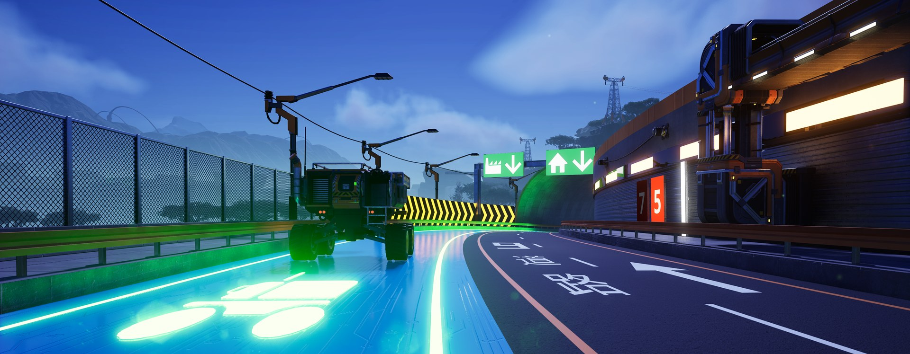
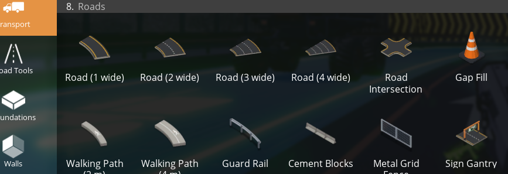
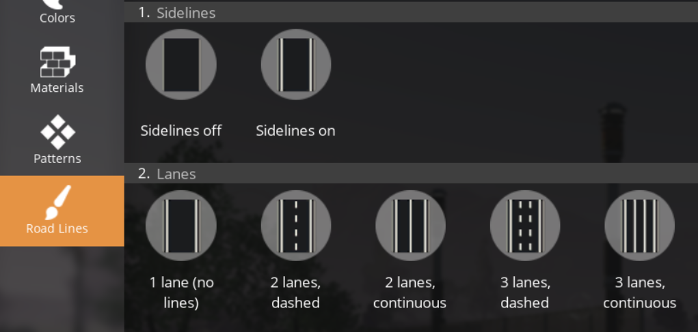
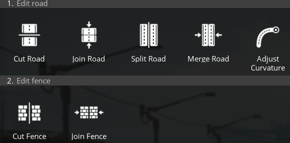
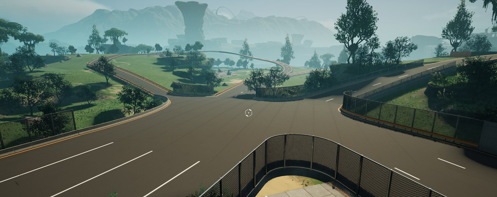
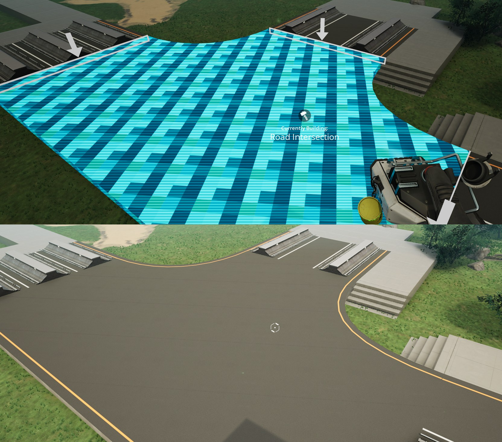
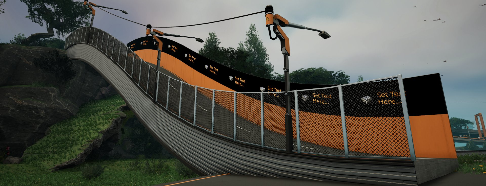
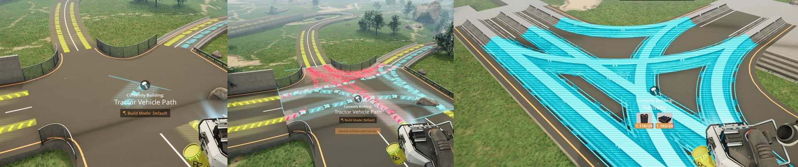
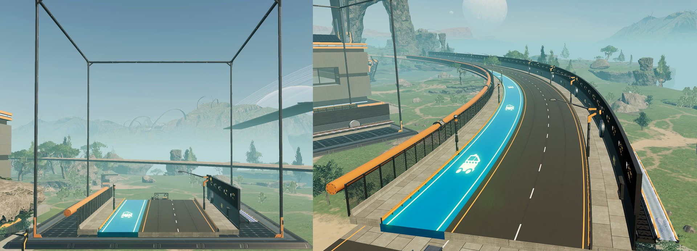

# Road Maker — ficsit.app page

## Name
Road Maker

## Mod reference (must be exactly this)
RoadMaker

## Short description (max 128 characters)
Curved roads with lane lines, side slopes, intersections, road tools, fences, walls, tunnel arches, a gantry and boom barriers.

## Full description (paste as Markdown)

**Road Maker** adds real roads to Satisfactory: curved roads in asphalt, concrete blocks or cyberpunk, lane lines, arrows, numbers, vehicle icons and text in any language you paint in the customizer, tools to cut, join, split, merge, reshape and round off roads and fences, side slopes that bank raised roads down to the terrain, a sign gantry across whole carriageways, tunnel arches, a boom barrier that stops self-driving vehicles, intersections that join up to six roads, fences and 4 m and 1 m fence walls that follow the road edge, one-click vehicle paths and railway tracks along the lanes, and your roads drawn on the map.

Roads, intersections and road fences unlock in the **Road Maker** milestone in Tier 1; roads and intersections are **free to build**. The fence walls unlock with the game's own progression (see below).

### Roads (1, 2, 3 and 4 foundations wide)
- Two clicks: start and end. The road curves like a vehicle path; the mouse wheel turns it.
- Build modes: **Default**, **Straight** (a straight line in any direction; snapped to a road end it meets it at an angle, ready for Smooth Joint), **Zoop** (straight on out of the start, at its direction and slope; the length follows your aim in whole metres) and **Smooth quadratic Bezier** (height eases in and out to join roads at different levels without kinks, up to 45°).
- **Road limits toggle (Left Alt, rebindable):** limits off = roads up to 1 km long with no turn or slope limits, and a 1 km build gun reach. Shown after the build mode's name ("Limits: ON / OFF") and in the key hint bar; remembered between sessions.
- Long roads and fences are drawn in sections of up to 100 m, so far-away parts stay light.
- Snaps to the ends of other roads and intersections, and to foundation edges (top level with the foundation).
- Hold the snap key and aim at a built road (or an intersection curb) to build a road right beside it, edge to edge, in one click.
- **Road materials** (Customizer › Material › Roads): Asphalt, Concrete Blocks and Cyberpunk (glowing lane lines), switched in place.
- 1 m thick, asphalt and concrete textures matched to the game's foundations; the sides, underside and ends in cement blocks (circuit board on cyberpunk roads).
- Dashed lane lines meet evenly where roads join: each road fits a whole number of dashes.
- Other buildings can be placed on roads, just like on foundations.

### Lane lines — Customizer › Road Lines

- **Sidelines:** on / off.
- **Lanes:** 1 lane, or 2, 3 and 4 lanes, dashed or continuous.
- **Markings:** Lane Arrow (straight, left, right, straight or left, straight or right, left or right), Lane Number (0 to 9), **Lane Vehicle** (the game's own Tractor, Truck, Explorer, Factory Cart and Cyberwagon icons) and **Lane Text**. Aim at a lane: a preview shows it on the lane centre, facing the way you look; the mouse wheel picks the variant, click paints it. Sized to the lane, lying on the road surface, in the road's line colours (glowing on cyberpunk roads), repaintable. Dismantle on its own or with the road. Middle click a marking to pick the same one again. On a 1-lane road a marking sits in the middle, sized to the road.
- **Lane Text:** words painted down a lane, one upright character after another, each as big as a lane number, read from top to bottom looking down the lane, in any language the game's font has (Chinese and Japanese too). Picking it opens a box to write the text (up to 24 characters; **R** opens it again); the preview shows it along the lane, following curves; click paints it. Like real paint it can't be edited: dismantle it and paint again. Middle click copies its text.
- The Quick Switch menu (E) shows the Road Lines options with their icons.
- Hover a road to preview, click to apply. Middle lines use the **primary colour**, side lines the **secondary colour**; roads have their own default swatch group ("Roads").

### Road Tools (build menu)

- **Edit road:** **Cut Road** (optionally cutting its fences too), **Join Road** (two roads end to end into one, when they lie on one smooth curve), **Split Road** (lengthwise, in 8 m steps), **Merge Road** (two roads side by side into one wider road, up to 4 wide), **Adjust Joint** and **Smooth Joint** (below) and **Side Slopes** (below).
- **Adjust Joint:** grab where two roads meet (or a free end) and move it; lane markings move along. Straight roads stay straight (they swing around their far end), a curved road meets a straight one flush, two curved roads meet in the joint's direction (the mouse wheel turns it). The joint moves at its own height; hold H and nudge up or down to change it.
- **Smooth Joint:** rounds the corner where two roads meet. Click the joint, drag away from it: both roads are cut back by the same distance (shown on screen) and a curve joins them flush, previewed in the roads' own look. The workflow for clean corners: lay straight roads corner to corner, move the corners with Adjust Joint, round them with Smooth Joint.
- **Edit fence:** **Cut Fence** and **Join Fence** (two fences of the same kind end to end, up to 1 km).
- Lines, paint, markings, fences and paths are kept. A green outline shows what will be joined or merged.

### Side Slopes (Road Tools)
- Banks a raised road, walking path or intersection down to the terrain (1 : 1.5, cement blocks, solid to walk and drive on), so roads on fill look built into the landscape.
- Aim at a road side or an intersection curb: a cyan cage shows the bank it gets, click adds it; aim at a bank (red cage) to remove it. Hold the snap key for both sides / all curbs.
- The banks stand on the terrain and rocks; plants, resource nodes and buildings don't stop them; banks of roads side by side run into each other. Where the ground is more than 8 m below, that side gets none (red lines). The space under the road is closed.
- Cut, adjusted and copied roads keep their banks and measure them again. Free.

### Boom Barrier
- A post on the road's edge and a red and white hologram arm across the road (2 to 20 m). Click the side for the post (a road or walking path edge), then the other side straight across. On foundations the post and the arm's end snap to the foundation grid; scroll turns the arm by 90°.
- Press E to choose its mode, shown by the post's light: **Automatic** (orange: the arm draws back while a vehicle is near), **Always open** (green), **Always closed** (red: self-driving vehicles coming towards it stop just before the arm, and drive on when it opens). Vehicles driven by a player are never stopped.
- The arm is a hologram: players, creatures and vehicles pass through it, and vehicle paths stay valid.
- The body can be painted (FICSIT colours by default).
- With **Automated Machines** installed, its window has an Automation button: set the mode from any event, and react to a vehicle waiting.

### Sign Gantry
- Two of the game's H-beams on the fence lines of roads with a beam across, 8 to 24 m above them, in the game's beam material and paint. Signs snap to the beam and columns every 2 m; wall attachments snap to it too.
- Click the first side (a road or walking path edge: an arrow shows where the column goes), then the other side: the same road's other edge, or the far edge of a road or path beside it, so one gantry spans the whole carriageway (3 to 60 m). Then the mouse sets the height and a click builds it.

### Tunnel Arch
- A rounded arch of concrete blocks over roads, following their curve and slope. Click the first side (a road or walking path edge, or a fence wall: the arch then rises from its top), click the other side (the far edge, a parallel road's edge or another fence wall: everything between is covered), then aim up or down to set the arc, up to a semicircle (the angle is shown on screen), and click.
- It runs along the whole stretch where the two sides run side by side; cut the road or fence for a shorter tunnel. Paintable.
- Ceiling lights, the belt ceiling mount and wall outlets hang inside it; signs, wall attachments, pillars and beams snap to nine points around the arch, inside and outside.
- Satisfactory can't dig into the ground, so it's a covered road: bury it with foundations, or end it at a cliff.

### Sign backgrounds
- **Chevrons Left** and **Chevrons Right** in the sign editor's Backgrounds, for every sign: curve warnings in the sign's own colours.

### Road Intersection

- Click the free road ends (or free intersection ends) you want to join, up to 6 and up to 200 m apart, then click away from them to build: they are joined with curved curbs. The aimed end is outlined in orange, picked ends in white with an arrow.
- Free ends are capped and can be built on again; intersections can join each other.
- Side lines along the curbs (Road Lines › Sidelines).

### Fences
- **Guard Rail** (a shaped steel beam in the game's H-beam material, paintable with swatches, on chrome posts), **Cement Blocks** (the concrete road's concrete, block joints, rounded edges) and **Metal Grid Fence** (chrome posts and a woven chain-link mesh).
- Aim at a road: the fence follows the whole edge on the side you look at, facing the road. On an intersection it follows the curb.
- Free placement anywhere, snapping to the foundation grid.

### Fence Walls — Walls › Fence Walls

4 m and 1 m tall walls that follow a road edge (centred on it) or an intersection's curb, like the fences.
- **FICSIT**, **Concrete** and **Steel Fence Wall** use the game's own wall materials and paint exactly like the game's walls. The customizer's **Material** tab switches a fence wall between concrete, FICSIT and steel in place, with a preview while aiming; switching costs the difference, like the game's walls.
- **Steel Mesh Fence Wall**: chrome posts and tubes with a woven chain-link mesh (the former 4 m metal grid fence).
- **1 m walls**: Concrete (plain, no grooves), FICSIT and Steel Fence Wall 1 m, for curbs, parking edges and planters, and the **Sign Wall 1 m** (the game's 4 m Label Sign design, scaled up to 8 x 1 m). 1 m and 4 m walls stack on each other and may share a course. Each costs what the game's wall of that material costs.
- **Sign Wall**: shows a sign design along its whole length (press E on it to edit it with the game's sign editor).
- Signs, wall attachments (conveyor, power and pipe wall mounts, wall holes, ladders...), beams, beam supports, pillars and the wall flood light snap to fence walls, following their curve and slope.
- Aim at the upper or lower half of a fence wall to stack another one above or below it. Hold the snap key (Ctrl) to replace the aimed fence wall with a different one, like the game's walls.
- Unlocks: FICSIT with Tier 1 **Base Building**, Steel Mesh with Tier 3 **Basic Steel Production**, Concrete and Steel together with the game's concrete and steel wall materials (AWESOME Shop).

### Lanes: paths and tracks

- **One-click vehicle paths and railway tracks:** hold the snap key (Ctrl) and aim at a lane: the path or track runs the whole lane, click to build. Scroll flips the direction.
- **Intersection connections:** hold a vehicle path or track and Ctrl and aim at an intersection: every connection through it is shown at once (paths by direction, tracks lane to lane), one click builds them all.
- On long roads every section of the lane is laid at once, and paths and tracks built in one click are joined to each other and to the ones already there (no gaps for vehicles or trains).

### Road Mode for blueprints

- A new build mode on any blueprint: click twice like a road and the blueprint is laid along the curve you draw, its arrow pointing the way.
- Roads, walking paths, fences, fence walls, tunnel arches, lane markings, belts, pipes, rails, hypertubes and vehicle paths running along the arrow bend with the curve; everything else repeats along it. Architecture pieces (walls, beams, pillars, roofs...) tilt with the road; buildings, machines, poles and the Foundations tab stay level.
- A tile is as long as the blueprint's content, not the designer box.
- Belts, pipes, rails, hypertubes and vehicle paths are joined from tile to tile and to the next placement; power poles without wires are wired along.
- Each placement leaves a Blueprint Road (a wireframe shown in Road Mode and with the dismantle tool): new placements snap to its ends, and dismantling it removes the whole placement.
- You pay exactly what the placement gives back when dismantled.

### Snapping for game buildings
- **Power poles** (all tiers) and **street lights** snap to the road's fence lines while holding the snap key (Ctrl); street lights face the road, scroll flips them.
- **Vehicle paths** and **railway tracks** snap to road and intersection ends — one point per lane (every 2 m on 1-lane roads) — and line up with the road, slope included; scroll flips them 180°.
- **Foundations, frames and ramps** snap to free road ends and intersection ends, top level with the road, in 4 m steps; scroll turns them 90°.
- **On and under roads:** foundations, ramps and frames sit on top of a road (or hang under it, top against it); ceiling lights, the belt ceiling mount and single wall outlets hang under roads; pillars stand on roads and walls along their surface.
- **Belts and power lines** pick the wall or ceiling mount / wall outlet on fence walls, under roads and in tunnels, like on the game's walls.
- Dismantling a road or intersection also removes the vehicle paths and tracks on it (refunded).

### Map
- Your roads and intersections are drawn on the game's map in their colours and side lines, overpasses over what they cross. **Show Roads on Map** (in the map's side menu, above Show Stamps on Map) turns them on / off.

### Performance
- Far-away roads, intersections and fences switch to simpler meshes; fences and fence walls have two distance levels (simpler, then simplest). Lane markings turn flat beyond 300 m and are hidden beyond 600 m.
- Saves stay small: only a few numbers per piece are saved, meshes are rebuilt on load.

### Notes
- Translations: Chinese (Simplified) by muaxl (the texts new in 1.6.0 are in English until translated). Every text can be translated; see GitHub issue #9.
- Multiplayer support is included but has not been tested yet — please report issues.
- Source code: https://github.com/jollyeye/Satisfactory-Road-Fence-Tool

## Changelog for version 1.6.0
**Added**
- **Boom Barrier** (next to the Sign Gantry): a post on the road's edge with a red and white hologram arm across the road (2 to 20 m), placed like the gantry, or on foundations (grid snap, scroll turns the arm by 90°). Press E to pick its mode, shown by the post's light: Automatic (orange: the arm draws back while a vehicle is near), Always open (green), Always closed (red: self-driving vehicles stop just before the arm and drive on when it opens; vehicles driven by a player are never stopped). The arm is a hologram: nothing collides with it and vehicle paths stay valid. Paintable body. With Automated Machines: an Automation button in its window (set the mode from events; know when a vehicle is waiting).
- **Side Slopes** (Road Tools): banks raised roads, walking paths and intersections down to the terrain. Per road side or intersection curb (snap key: all at once); a cage previews the bank. Banks stand on terrain and rocks, run into the banks beside them, and are left out where the ground is more than 8 m below. The space under the road is closed.
- **Smooth Joint** (Road Tools): rounds the corner where two roads meet with a curve that meets both flush; both roads are cut back by the distance you drag.

**Changed**
- **Adjust Curvature is now Adjust Joint:** straight roads stay straight (they swing around their far end), a curved road meets a straight one flush, and the joint moves at its own height (H + nudge changes it) instead of dropping to the ground.
- **Straight build mode** is a straight line in any direction (it was locked to the road it started from); snapped to a road end it meets it at an angle, ready for Smooth Joint.
- **Dashed lane lines** meet evenly where two roads join: each road fits a whole number of dashes. Existing roads shift their dashes once.
- The sides, underside and ends of roads, walking paths, intersections and gap fills are cement blocks (cyberpunk: circuit board) instead of plain concrete.

**Fixed**
- Multiplayer: players who joined a game should no longer rubber-band while walking on very long roads (limits off) (issue #10; not yet confirmed with two players).
- The Side Slopes tool no longer rebuilds large intersections while aiming at them (frame drops).

## Changelog for version 1.5.1
**Fixed**
- Dismantling many roads at once could crash the game a minute later in its vehicle path code, and an autosave made in between could no longer be loaded (issue #11). The vehicle paths on a dismantled road or intersection are now removed just after it, one at a time, as if dismantled by hand; tracks and lane markings already being dismantled are no longer handed over twice. Console: `RM.DismantleRiders 0` leaves paths, tracks and markings in place when a road is dismantled.

**Translations**
- Chinese (Simplified) complete: every text, including the 1.5.0 buildings and tools. Thanks to muaxl!

## Changelog for version 1.5.0
**Added**
- Tunnel Arch: a rounded concrete-block arch over roads, following their curve and slope. Click the two sides (road or walking path edges, or fence walls: the arch rises from their top; several parallel roads are covered at once), then aim to set the arc, up to a semicircle, shown on screen. Lights, belt mounts and outlets hang inside; signs, wall attachments, pillars and beams snap to nine points around the arch. Works in Road Mode (a tunnel running the whole blueprint becomes one arch over the whole curve).
- Lane Text: text painted down a lane in any language, one upright character after another, as big as the lane numbers, in the road's line colours (glowing on cyberpunk roads). Write it in its box (R opens it again), preview it along the lane, click to paint; middle click copies it.
- 1 m fence walls: Concrete (no grooves), FICSIT and Steel, and the Sign Wall 1 m (the game's Label Sign design, 8 x 1 m). They stack with the 4 m walls and may share a course with them.
- Sign Gantry over whole carriageways: pick both sides (any road or walking path edges straight across, up to 60 m); arrows show where the columns go.
- On and under roads: foundations, ramps and frames sit on top of roads or hang under them; ceiling lights, the belt ceiling mount and single wall outlets hang under roads; pillars and the big pillar support stand on roads and fence walls along the surface.
- Belts and power lines switch to the wall / ceiling mount and the wall outlet on fence walls, under roads and in tunnels, like on the game's walls.
- Beams and beam supports snap to fence walls and tunnel arches, straight out of the face, following curves and slopes (diagonal and free form modes work too).
- Road Mode: architecture pieces and several logistics pieces tilt with the road (issue #7); the wall flood light snaps to fence walls; live cost while drawing.
- Translations: every text can now be translated. Chinese (Simplified) by muaxl (issue #9).

**Changed**
- Road Mode: a tile is as long as the blueprint's content, not the designer box (issue #8): a 6 m road in an 8 m designer no longer leaves 2 m gaps.
- Fence walls cost what the game's wall of the same material costs (they were cheaper). Walls already built give back the new cost.
- A fence wall stacked on another one turns round with the scroll wheel.

**Fixed**
- Stacked fence walls no longer flicker where they meet.
- Road Lines options showed blank icons in the Quick Switch menu (E).
- Road Mode: the game's pieces show their build effect at once (they appeared about 5 s late); the blueprint's cost is no longer taken twice.
- Metal grid fence material: compiles under DirectX 11 on the new engine.

**Note**
- Built for Satisfactory 1.2.6 (build 520140) with SML 3.12.1.

## Changelog for version 1.4.1
**Fixed**
- Satisfactory 1.2.6 (build 520140): the game crashed within seconds of looking at a Road Maker road, fence, intersection or walking path. The update added a function to one of the game's interfaces, so Road Maker 1.4.0 ended up calling the wrong code. 1.4.1 is rebuilt for the new game version and needs build 520140 or newer.

**Note**
- SML's official headers for 1.2.6 aren't out yet, so this version is built on community-reconstructed headers ([SML PR #433](https://github.com/satisfactorymodding/SatisfactoryModLoader/pull/433)). Everything tested fine (building, Road Mode, sign walls, editing, save and load), but if you run into a crash, please report it on GitHub. A rebuild on the official headers will follow when they're published.
- Thanks to muaxl and KemiteMiata for the detailed crash analysis.

## Changelog for version 1.4.0
**Added**
- Walking paths, 2 m and 4 m wide (thanks to the idea in issue #1): build them right beside a road with the snap key to widen it (one on each side of a 1-wide road makes it 1.5 foundations wide), and fences snap to their outer edge. Concrete blocks by default; no vehicle paths, tracks or lane markings on them. A 4 m path splits into two 2 m paths and two 2 m paths merge into a 4 m one. They snap to walking path ends and to road ends every 2 m across.

- Road fences (guard rail, cement blocks, grid fence) and fence walls snapped to a road edge or an intersection curb turn round with the scroll wheel, to face away from the road, like the street lights. The Metal Grid Fence and the Steel Mesh Fence Wall now stand centred on their line (3 cm over), so they stay in place when turned.

- Sign wall: a 4 m fence wall showing a sign design along its whole length, following its curve. Press E on it to edit the design in the game's sign editor (same layouts, backgrounds and animations as the 8 x 4 m small billboard); copy / paste settings between sign walls, and middle click a sign wall to build more with the same design. Visible from as far as a billboard. Costs what a Small Billboard does (3 encased industrial beams, 4 copper sheets, 1 crystal oscillator) per 8 m.

- Fences fill gaps: snapped to a road edge that already has fences on it, a new fence fills just the free stretch you aim at, end to end with its neighbours. Cut a wall, dismantle a piece and put a sign wall in its place.

- Roads on the map are now drawn by the graphics card: sharp at every zoom and far less memory than the old map pictures (a few MB instead of up to a few hundred for a big network). More detail as you zoom in: walking paths from 1.5x, lane lines from 6x, and lane markings (arrows, numbers, vehicles) once they are big enough on your screen, so larger screens and map zoom mods show them sooner. Still the bottom layer of the map, under other map mods.

- Cyberpunk road on Low graphics quality: the circuit grooves are back (from a small baked texture, ~1.3 MB), instead of plain plastic. High quality is unchanged.

- Gap Fill: fills the gap between roads with road surface, at their height. Click road, walking path and intersection edges around the area in any order; they are cut where they cross or joined by straight lines, then click inside the shape to build. Takes the look of the first edge's road; fence walls snap to its sides.

- Lighter meshes: roads, walking paths, fences and fence walls now have cross-sections only where they bend, and one every 4 m on straight stretches (was every 0.5–1 m everywhere). Far fewer triangles, faster to build, same look; posts, panels, block joints and sign designs stay where they were. Intersection curb lines are smooth curves with far fewer triangles.

- Road Mode for blueprints: a new build mode on any blueprint. Click twice like a road and the blueprint is laid along the curve you draw, its arrow pointing the way. Roads, walking paths, fences, fence walls, lane markings, belts, pipes, rails, hypertubes and vehicle paths running straight along the arrow bend with the curve (the ones running the whole blueprint stretch over it); everything else repeats tile after tile, each piece at its own distance from the centre, so the outer side of a curve spreads more. Buildings, machines and poles stay level; signs and wall attachments on a bent fence wall follow it. Belts, pipes, rails and hypertubes are joined from tile to tile, and power poles and single wall outlets with no wire in the blueprint are wired to their copy on the next tile. Costs exactly what the placement gives back when dismantled; the whole placement dismantles as one blueprint. Each placement lays a hidden Blueprint Road along its centre (as wide as the blueprint), shown as a wireframe in Road Mode and with the dismantle tool: new placements snap to its ends (meeting it head-on, the blueprint is laid the other way so its sides match; the mouse wheel flips it), and dismantling it removes the whole placement. Belts, pipes, rails, hypertubes and vehicle paths whose free ends meet another placement's are linked to it; vehicle paths are checked again after placing (a blueprint keeps a red result from the designer, e.g. a path starting next to the designer's terminal). Sign walls keep their design. The tiles are built over a few frames after the click, so the game doesn't stall on long placements. Works in multiplayer through the game's own construct message (not yet tested with a client).

**Fixed**
- Crash when a road, walking path or intersection was dismantled or replaced while its build animation was still running, e.g. merging roads in quick succession (thanks Diquan360, issue #5).
- Map: until the map has been opened once, Road Maker looks for it once a second instead of four times, and afterwards only checks the map's own widgets (thanks scotthowson, issue #3).
- Blueprints: Road Maker pieces now show in the blueprint hologram (with their paint; the sign gantry complete), lane markings are saved in blueprints, and sign walls keep their design.
- Roads and walking paths aimed at the middle of a foundation (or the blueprint designer's floor) stand on top of it, on the foundation grid; near an edge they still snap flush to the edge.
- Middle click on a road or walking path also copies its look (Concrete Blocks, Asphalt, Cyberpunk) and its lines, not only the paint.

## Changelog for version 1.3.1
**Improved**
- Linux dedicated servers are supported (thanks to the request in issue #2).
- Less background work in every session (thanks to scotthowson, issue #3): the map, customizer and hotbar checks no longer go through every on-screen widget several times a second, and the debug logs are off by default.

**Changed**
- Roads on the map are drawn directly on the terrain, under everything else on the map, including what other map mods draw (e.g. vehicle paths).
- A fence wall (or a road fence of the same kind) is refused only when it follows another along the same curve. Touching or overlapping in part, like two walls meeting where roads split, is allowed and the hologram turns yellow, like the game's buildings that touch.

**Fixed**
- Picking a road from the hotbar or the radial menu no longer loses the "Toggle Limits" key hint.
- Middle click on a lane marking (arrow, digit, vehicle) picks it again, ready to paint another, like the game's own sample (on whatever key Sample is bound to; the build gun comes out if it is put away).
- "Show Roads on Map" keeps its tick when the map is opened again.
- The chain-link mesh of the Metal Grid Fence and the Steel Mesh Fence Wall no longer breaks into flat bands far along long fences (past about 500 m).
- The concrete sides of roads no longer turn dark all at once along a curve: they are lit by their real facing, fading smoothly like the game's walls.
- The cyberpunk road's circuit pattern no longer stretches (rings turning into ovals) far along long roads.

## Changelog for version 1.3.0
**New**
- **Join Road** and **Merge Road** (Road Tools > Edit road): join two roads end to end into one (same width, lying on one smooth curve), or merge two roads side by side into one wider road (edge to edge, level, starting and ending together, up to 4 wide). Lines, look, paint, markings, paths, tracks and fences are kept; a green outline shows the result.
- **Join Fence** (Road Tools > Edit fence): two fences of the same kind and look end to end into one, up to 1 km.
- **Zoop** road build mode: the road goes straight on out of its start, in its direction and slope; the length follows your aim in whole metres and stops on the longest road allowed.
- **Road limits toggle:** Left Alt (rebindable in Options > Controls > Road Maker) while holding a road turns the limits off / on: up to 1 km long, no turn or slope limits, 1 km build gun reach. Shown after the build mode's name and in the key hint bar; remembered between sessions. Replaces the Long Curve mode of the test builds.
- **Lane Vehicle marking** (Road Lines > Markings): the game's own Tractor, Truck, Explorer, Factory Cart and Cyberwagon icons painted on a lane, in the road's line colours, repaintable.
- **Sign backgrounds:** Chevrons Left and Chevrons Right in the sign editor, for every sign.
- **Roads on the map:** roads and intersections drawn on the game's map, with **Show Roads on Map** in the map's side menu.
- **Build animations and sounds:** roads and fences are revealed along their length, intersections spread out from the road ends, the sign gantry grows from the bottom up, with the game's build sounds.

**Improved**
- Holograms show the real thing: roads, intersections, fences, fence walls, the sign gantry and lane markings preview in their own materials and paint (middle click copies paint to them).
- **Guard Rail:** new beam shape (taller, covers the posts), the game's H-beam material, paintable with swatches; chrome posts with rounded edges.
- **Cement Blocks:** the concrete road's concrete, rounded edges.
- **Metal Grid Fence and Steel Mesh Fence Wall:** chrome posts and tubes with rounded edges, and a woven chain-link mesh in matte metal (flat on low graphics quality).
- Long roads and fences are drawn in sections of up to 100 m; snap-key lane paths and tracks cover every section of a long road at once.
- Paths and tracks built in one click are joined to each other and to the ones already there.
- Intersection curbs follow the same curves as the vehicle paths through them.
- Lane markings on a 1-lane road: one spot in the middle, sized to the road. Middle click a lane marking to pick it again.
- Intersection connections (snap key on an intersection) are much lighter: about 4x the frame rate on a busy intersection.
- Far fences use a simpler middle level of detail.

**Fixed**
- Railway tracks built through intersections and along lanes in one click were not connected at the joints (trains derailed there).
- Signs no longer jump onto a fence wall while setting their height on a leg.

## Changelog for version 1.2.1
**Improved**
- Intersections have a smooth top surface: where the road ends are at different heights it now rises as one even slope instead of folding along long thin triangles (better lighting, paths and vehicles ride it smoothly). Existing intersections update on load; things built on an uneven one may sit a few centimetres off where the old folds were.
- Intersection connections (vehicle path + snap key on an intersection) follow the intersection's surface instead of cutting straight through it when the road ends are at different heights.
- Roads snap to the side of a wider road end too, in 8 m steps, not only its centre: the pieces of a split road can be joined back next to a piece that is already attached (e.g. a 3-wide road split in three, sides removed: the 1-wide sides snap back on both sides of the middle one).
- A road built beside a road (snap key) can be locked and nudged like snapped fences: the whole road moves up / down, and along the directions nearest to where you look.
- Road holograms show a flat white arrow on top pointing the way the road runs (its lines and markings follow that direction).
- Signs snap to fence walls and the sign gantry automatically, no snap key needed (like wall attachments).
- Fence walls can no longer be built inside another fence wall (the hologram turns red, "Another fence wall is already there"), like the game's walls; stacking on top / below and meeting end to end still work.
- Road fences snapped with the snap key can no longer be built on top of the same kind of road fence ("The same fence is already there"); a different kind still replaces it.
- Lane markings keep their detailed shape (lying on the road) up to 300 m away, instead of 50 m.

**Fixed**
- Fence walls stack on other fence walls again without the snap key (aim at the upper half to build on top, the lower half to build below). The snap key still replaces the aimed fence wall with a different one, and still snaps fences to road edges and curbs.
- Lane markings no longer get in the way: aiming at an arrow or number counts as aiming at the road under it (one-click lane paths and tracks, roads beside roads, fences, the gantry, Cut / Split / Adjust).
- Road Intersection: clicking in the middle of the picked road ends builds it, also on small intersections (it used to pick or unpick the nearest end instead).
- Street lights snapped between two roads side by side no longer flicker between the two roads: they face the road you aim at.
- After loading a save a second time in the same session, the customizer's Road Lines tab showed the previous tab's pictures instead of its own icons.
- The customizer's info box showed the previous option's picture for Road Lines options; it now shows the option's own icon.

## Changelog for version 1.2.0
- **New curves:** roads and fences are drawn as quadratic Bezier curves. Gentle bends are one curve through the point where the start and end directions meet; S-curves, wide turns and U-turns become two smoothly joined curves. Same two clicks as before: the mouse wheel turns the start direction before the first click and the end direction before the second.
- **New: Road (4 wide)**, 32 m, with its own build menu icon.
- **Road Lines: 4 lanes** (dashed or continuous), for any road width.
- The Smooth build mode is now called "Smooth (quadratic Bezier)".
- **Nudging:** with the hologram locked (H), the arrow keys move the point being placed along its own direction and across it (not the world axes); this now works for the end point too.
- **Asphalt follows the road:** the asphalt texture runs along the road's curve instead of being projected from above.
- **New: roads beside roads.** Hold the snap key and aim at a built road: the new road becomes the parallel of that whole road, on the side you aim at, edge to edge and flush with its top (to cover gaps with a flat surface). One click builds it. No length, turn radius or slope rules; only a bend too tight for the new road's width is refused.
- Roads beside intersections: the same with the snap key on an intersection builds a road along the aimed curb, outside the junction.
- **New build menu category: Road Tools** (Builder tab), with **Cut Road** (section Edit road): aim at a road, an orange outline shows the cut, click to split the road into two that keep its curve, lines and paint. Train tracks and vehicle paths built on the road are cut at the same place (refused, with a message, if one of their pieces would be shorter than the game allows).
- **Cut Road: new build mode "Cut also fences"**: this road's fences are cut at the same place too (road fences standing on it, fence walls on its edges, stacked walls included; white outlines show them). Roads beside it and their fences are left alone.
- **New: Cut Fence** (Road Tools > Edit fence): splits a road fence or fence wall where you aim, keeping its course, side, material and paint; nothing else is cut. Hold the snap key near a road end (e.g. where you cut the road) to snap the cut in line with it.
- **New: Split Road** (Road Tools > Edit road): aim across a road 2 or more wide; a cyan line along the road shows where it is split lengthwise, in steps of 8 m (a 2 wide road becomes two 1 wide roads, a 3 wide one 1 + 2 or 2 + 1 depending on where you aim, a 4 wide one 1 + 3, 2 + 2 or 3 + 1). One click replaces it with two roads side by side that keep its curve, lines and paint.
- **New: Adjust Curvature** (Road Tools > Edit road): orange circles mark the road ends near you. Click one to grab the end (together with the end of the road joined to it, when two roads meet end to end); move it like a normal road end (mouse wheel turns it, the snap key snaps it to a free road end, one road also snaps to foundation edges like a new road and two roads to the 4 m grid on top of a foundation, H holds it and the arrow keys nudge it); the grabbed roads show as a light-blue wireframe (still solid underfoot) and their new curves as holograms (Smooth: the height eases in and out); a second click replaces them with the new curves, keeping their other ends, lines and paint. Ends joined to an intersection stay.
- **New: road materials** (Customizer > Material tab > **Roads**): **Asphalt**, **Concrete Blocks** (big 4 x 2 m running-bond blocks with bevelled joints) and **Cyberpunk** (glossy plastic in the primary colour (FICSIT orange until painted) with a circuit-board pattern carved into the normal map, only faintly visible in colour; all lane lines glow in the secondary colour). Aim at a road or intersection and click to switch it in place; new roads copy the look of the road they snap to. Both have a cheaper version on low graphics quality (no bevels / circuit pattern). Lane lines, paint and the cost of switching work like for the fence walls.
- **New: signs on fence walls**: hold the snap key and aim at a fence wall: the sign goes flat on its face, turned and tilted with the curve, snaps every 1 m in height (5 levels on a 4 m wall: both edges and three on the face), turns 45 degrees per scroll step, has no leg and builds with one click. Without the snap key signs place as usual.
- **New: Sign Gantry** (build menu, Roads): two of the game's H-beams standing on upright connectors on the fence lines of a road, with a beam (H-beam and shelf-beam ends) across the top, at least 8 m above the road. Aim at a road and click to put it across, then the mouse sets the height of the beam (every 2 m, up to 24 m) and a second click builds it. Hold the snap key and aim one of the game's signs at the gantry: it goes flat on the face you aim at, on the beam (front or back, a snap point every 2 m along it, at its bottom edge, middle or top edge) or on a column (any face, every 2 m up) (scroll turns it 45 degrees). Costs steel beams and pipes (per 8 m of steel), so it unlocks with the Road Maker milestone but needs Tier 3 steel to afford.
- **Wall attachments snap to fence walls and the gantry** (no snap key): conveyor, power and pipe wall mounts, wall holes and the like go flat on the face, free along the wall at 1 m heights (every 2 m on the gantry), tilt with a climbing wall, and turn with the scroll wheel. Conveyor wall mounts and holes stay level with the world so belts run straight.
- **Nudge snapped fences**: a fence following a road edge or curb can now be locked (hologram lock key) and nudged as a whole, up / down and along the horizontal axes nearest the camera.
- **New: Lane markings** (customizer, Road Lines tab, section Markings): **Lane Arrow** and **Lane Number**, sized to the lane they are painted in (wider lanes get bigger markings, up to a lane one and a half foundations wide). They lie on the road surface, following slopes and curves (flat beyond 300 m, hidden beyond 600 m), and move along when the road is reshaped with Adjust Curvature. Pick one, aim at a road: a ghost shows it in the middle of the lane you aim at, pointing the way you are looking along the road; the mouse wheel picks the variant (arrows: straight, left, right, straight or left, straight or right, left or right; numbers: 0 to 9) and the click paints it. Real flat geometry, stretched along the road like painted ones. It starts in the colour of the road's lines (the middle lines' colour; on the cyberpunk road it glows like its lines), and can be repainted with a colour or switched in the Material tab. Dismantle one on its own or together with the road. Free.
- **Changed:** fences and fence walls snap to roads, curbs and other fences only while the snap key is held; otherwise they place freely.
- Build menu order: roads 1, 2, 3, 4 wide, then the intersection and road fences.

## Changelog for version 1.1.1
- Road Lines options are no longer listed as items (e.g. under Parts in the creative mode item list).
- Switching a fence wall's material in the customizer now turns it into the real building of that material (its name, recipe and dismantle refund change), keeping its course and paint. Switching again right away works.
- The material switch pays the cost difference from your inventory and the Dimensional Depot, and is free with No Build Cost. When it cannot be applied, the game's failure sound plays.
- Fence walls get the game's outline while aiming with a material: white when the material can be applied, red when the wall already has that material or you cannot pay for it.
- Customizer icons stay correct after visiting the Road Lines tab (no more wrong pictures or colours in other tabs).
- **Road fences replace each other:** hold the snap key and aim at a guard rail, cement blocks or metal grid fence with another road fence selected: it takes its place on click (the old one is refunded). Fence walls still only replace fence walls.
- Fixed the end caps of the cement blocks (a wedge stuck out past the sloped sides).
- Road Lines options bound to the hotbar show their own picture (they showed a blank white / magenta swatch).

## Changelog for version 1.1.0
- **New: Fence Walls** (Walls › Fence Walls; the 4 m metal grid fence is now the Steel Mesh Fence Wall, unlocked with Basic Steel Production; FICSIT with Tier 1 Base Building, concrete and steel with their wall materials): a 4 m wall along the road edge or an intersection curb, stackable, paintable, in concrete, FICSIT or steel (switchable in the customizer).
- **One-click vehicle paths and railway tracks:** hold the snap key (Ctrl) and aim at a lane of a road: the path or track is laid along the whole lane, end to end — click to build. Scroll flips the direction; next to an existing path it continues that path's direction and joins it, and tracks connect to free track ends.
- **One-click intersection connections:** hold a vehicle path or railway track and the snap key (Ctrl) and aim at an intersection: every arriving path is connected to every leaving path on the other ends (no U-turns), and every track end to the track in the same lane on each other end (left to left, middle to middle, right to right, in the travel direction; switches form on their own), shown at once; one click builds them all. If one connection is invalid (red), improve the intersection until all of them fit.
- **New intersection placement:** click each free road end to pick it (up to 6, up to 200 m apart; click again to drop it), then click away from the ends to build. The aimed end gets an orange outline, picked ends a white outline and an arrow, visible through other buildings.
- **Foundations snap to free road ends and intersection ends:** edge on the end, top level with the road, in 4 m steps across it; scroll turns them 90°. Works for foundations, frames, ramps (high or low side at the road) and inverted ramps.
- Dismantling a road or intersection also dismantles the vehicle paths and railway tracks lying on it (refunded too).
- Intersections of two roads at an angle (e.g. 90°) now build: the curved, ring-shaped piece is filled correctly, and big intersections get rounder curbs.
- Fences and fence walls get a second, simplest distance level (beyond 150 m / 200 m).
- Roads without side lines use the full width for their lanes (lane lines and snap points).
- Power poles and street lights snap exactly on the road edge.
- New **Smooth** build mode for roads: the height eases in and out and matches the slope of the roads it connects, so linking roads at different heights has no kinks when seen from the side. Allows up to 45°.
- Vehicle paths and railway tracks follow the road's slope at road-end snap points (start and end).
- Snap points follow the lanes: 1-lane roads every 2 m, 2- and 3-lane roads one point in the middle of each lane. Intersection ends use the lanes of the road joined there.
- Snapping only uses the road or intersection you aim at, and the game's own snapping to existing vehicle paths and tracks takes priority.
- Fixed "vehicles collide with the terrain" when a vehicle path snaps to the raised end of a road (the point moves onto the road when there is no floor beyond the end).
- Railway tracks no longer float above the road at snap points.

## Changelog for version 1.0.0
First release: roads (1/2/3 wide), Road Lines customizer tab, road intersections with side lines, four fence types, snapping for power poles, street lights, vehicle paths and railway tracks, distance LODs.

## Tags (suggested)
Buildings, Quality of Life, Vehicles, Logistics
