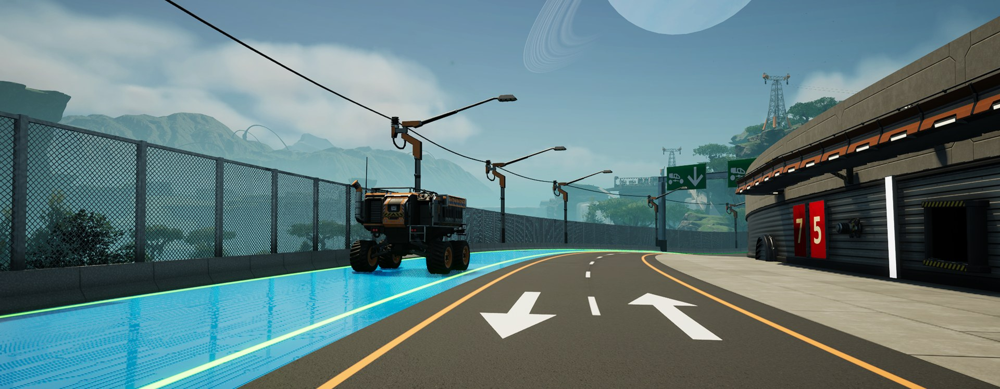
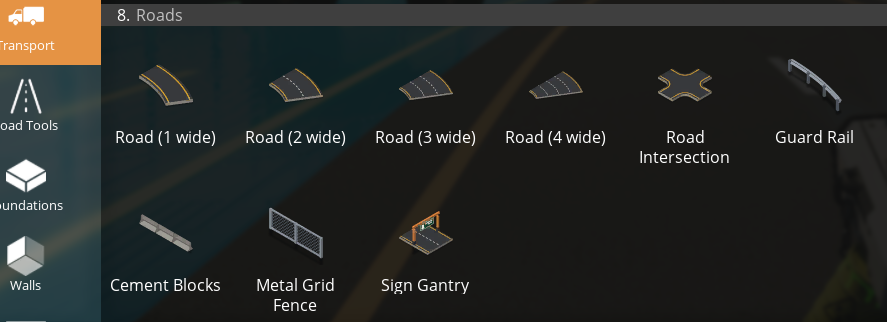
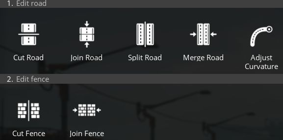

# Road Maker — ficsit.app page

## Name
Road Maker

## Mod reference (must be exactly this)
RoadMaker

## Short description (max 128 characters)
Curved roads with lane lines and markings, intersections, road tools, fences, fence walls and a sign gantry, plus smart snapping.

## Full description (paste as Markdown)

**Road Maker** adds real roads to Satisfactory: curved roads in asphalt, concrete blocks or cyberpunk, lane lines, arrows and numbers you paint in the customizer, tools to cut, split and reshape roads, a sign gantry, intersections that join up to six roads, fences and 4 m fence walls that follow the road edge, and one-click vehicle paths and railway tracks along the lanes.

Roads, intersections and road fences unlock in the **Road Maker** milestone in Tier 1; roads and intersections are **free to build**. The fence walls unlock with the game's own progression (see below).

### Roads (1, 2, 3 and 4 foundations wide)
- Two clicks: start and end. The road curves like a vehicle path; the mouse wheel turns it.
- Build modes: **Default**, **Straight**, and **Smooth** (height eases in and out to join roads at different levels without kinks, up to 45°).
- Snaps to the ends of other roads and intersections, and to foundation edges (top level with the foundation).
- Hold the snap key and aim at a built road (or an intersection curb) to build a road right beside it, edge to edge, in one click.
- **Road materials** (Customizer › Material › Roads): Asphalt, Concrete Blocks and Cyberpunk (glowing lane lines), switched in place.
- 1 m thick, asphalt and concrete textures matched to the game's foundations.
- Other buildings can be placed on roads, just like on foundations.

### Lane lines — Customizer › Road Lines

- **Sidelines:** on / off.
- **Lanes:** 1 lane, or 2, 3 and 4 lanes, dashed or continuous.
- **Markings:** Lane Arrow (straight, left, right, straight or left, straight or right, left or right) and Lane Number (0 to 9). Aim at a lane: a preview shows it on the lane centre, facing the way you look; the mouse wheel picks the variant, click paints it. Sized to the lane, lying on the road surface, in the road's line colours (glowing on cyberpunk roads), repaintable. Dismantle on its own or with the road.
- Hover a road to preview, click to apply. Middle lines use the **primary colour**, side lines the **secondary colour**; roads have their own default swatch group ("Roads").

### Road Tools (build menu)

- **Cut Road** (optionally cutting its fences too), **Split Road** (lengthwise, in 8 m steps), **Adjust Curvature** (grab a road end and reshape it; lane markings move along) and **Cut Fence**. Lines, paint, fences and paths are kept.

### Sign Gantry
- Two of the game's H-beams on the fence lines of a road with a beam across, 8 to 24 m above it. Signs snap to the beam and columns every 2 m; wall attachments snap to it too.

### Road Intersection

- Click the free road ends (or free intersection ends) you want to join, up to 6 and up to 200 m apart, then click away from them to build: they are joined with curved curbs. The aimed end is outlined in orange, picked ends in white with an arrow.
- Free ends are capped and can be built on again; intersections can join each other.
- Side lines along the curbs (Road Lines › Sidelines).

### Fences
- **Guard Rail**, **Cement Blocks** (with block joints) and **Metal Grid Fence**.
- Aim at a road: the fence follows the whole edge on the side you look at, facing the road. On an intersection it follows the curb.
- Free placement anywhere, snapping to the foundation grid.

### Fence Walls — Walls › Fence Walls

4 m tall walls that follow a road edge (centred on it) or an intersection's curb, like the fences.
- **FICSIT**, **Concrete** and **Steel Fence Wall** use the game's own wall materials and paint exactly like the game's walls. The customizer's **Material** tab switches a fence wall between concrete, FICSIT and steel in place, with a preview while aiming; switching costs the difference, like the game's walls.
- **Steel Mesh Fence Wall**: a steel frame with a diamond wire mesh (the former 4 m metal grid fence).
- Signs and wall attachments (conveyor, power and pipe wall mounts, wall holes, ladders...) snap to fence walls.
- Aim at the upper or lower half of a fence wall to stack another one above or below it. Hold the snap key (Ctrl) to replace the aimed fence wall with a different one, like the game's walls.
- Unlocks: FICSIT with Tier 1 **Base Building**, Steel Mesh with Tier 3 **Basic Steel Production**, Concrete and Steel together with the game's concrete and steel wall materials (AWESOME Shop).

### Lanes: paths and tracks

- **One-click vehicle paths and railway tracks:** hold the snap key (Ctrl) and aim at a lane: the path or track runs the whole lane, click to build. Scroll flips the direction.
- **Intersection connections:** hold a vehicle path or track and Ctrl and aim at an intersection: every connection through it is shown at once (paths by direction, tracks lane to lane), one click builds them all.

### Snapping for game buildings
- **Power poles** (all tiers) and **street lights** snap to the road's fence lines while holding the snap key (Ctrl); street lights face the road, scroll flips them.
- **Vehicle paths** and **railway tracks** snap to road and intersection ends — one point per lane (every 2 m on 1-lane roads) — and line up with the road, slope included; scroll flips them 180°.
- **Foundations, frames and ramps** snap to free road ends and intersection ends, top level with the road, in 4 m steps; scroll turns them 90°.
- Dismantling a road or intersection also removes the vehicle paths and tracks on it (refunded).

### Performance
- Far-away roads, intersections and fences switch to simpler meshes; fences and fence walls have two distance levels (simpler, then simplest). Lane markings turn flat beyond 50 m and are hidden beyond 600 m.
- Saves stay small: only a few numbers per piece are saved, meshes are rebuilt on load.

### Notes
- Multiplayer support is included but has not been tested yet — please report issues.
- Source code: https://github.com/jollyeye/Satisfactory-Road-Fence-Tool

## Changelog for version 1.2.1
- Fixed: the customizer's info box showed the previous option's picture for Road Lines options; it now shows the option's own icon.
- Fixed: after loading a save a second time in the same session, the customizer's Road Lines tab showed the previous tab's pictures instead of its own icons.
- Road Intersection: clicking in the middle of the picked road ends builds it, also on small intersections (it used to pick or unpick the nearest end instead); click near an end to pick or unpick it.
- Intersections have a smooth top surface: where the road ends are at different heights it now rises as one even slope instead of folding along long thin triangles (better lighting, paths and vehicles ride it smoothly). Existing intersections update on load; things built on an uneven one may sit a few centimetres off where the old folds were.
- Intersection connections (vehicle path + snap key on an intersection) follow the intersection's surface instead of cutting straight through it when the road ends are at different heights.
- Street lights snapped between two roads side by side no longer flicker between facing one road and the other: they face the road you aim at.
- Signs snap to fence walls and the sign gantry automatically again, no snap key needed (like wall attachments).
- Lane markings no longer get in the way: aiming at an arrow or number counts as aiming at the road under it (one-click lane paths and tracks, roads beside roads, fences, the gantry, Cut / Split / Adjust).
- Fixed: fence walls stack on other fence walls again without the snap key (aim at the upper half to build on top, the lower half to build below). The snap key still replaces the aimed fence wall with a different one, and still snaps fences to road edges and curbs.

## Changelog for version 1.2.0
- **New curves:** roads and fences are drawn as quadratic Bezier curves. Gentle bends are one curve through the point where the start and end directions meet; S-curves, wide turns and U-turns become two smoothly joined curves. Same two clicks as before: the mouse wheel turns the start direction before the first click and the end direction before the second.
- **New: Road (4 wide)**, 32 m, with its own build menu icon.
- **Road Lines: 4 lanes** (dashed or continuous), for any road width.
- The Smooth build mode is now called "Smooth (quadratic Bezier)".
- **Nudging:** with the hologram locked (H), the arrow keys move the point being placed along its own direction and across it (not the world axes); this now works for the end point too.
- **Asphalt follows the road:** the asphalt texture runs along the road's curve instead of being projected from above.
- **New: roads beside roads.** Hold the snap key and aim at a built road: the new road becomes the parallel of that whole road, on the side you aim at, edge to edge and flush with its top (to cover gaps with a flat surface). One click builds it. No length, turn radius or slope rules; only a bend too tight for the new road's width is refused.
- Roads beside intersections: the same with the snap key on an intersection builds a road along the aimed curb, outside the junction.
- **New build menu category: Road Tools** (Builder tab), with **Cut Road** (section Edit road): aim at a road, an orange outline shows the cut, click to split the road into two that keep its curve, lines and paint. Train tracks and vehicle paths built on the road are cut at the same place (refused, with a message, if one of their pieces would be shorter than the game allows).
- **Cut Road: new build mode "Cut also fences"**: this road's fences are cut at the same place too (road fences standing on it, fence walls on its edges, stacked walls included; white outlines show them). Roads beside it and their fences are left alone.
- **New: Cut Fence** (Road Tools > Edit fence): splits a road fence or fence wall where you aim, keeping its course, side, material and paint; nothing else is cut. Hold the snap key near a road end (e.g. where you cut the road) to snap the cut in line with it.
- **New: Split Road** (Road Tools > Edit road): aim across a road 2 or more wide; a cyan line along the road shows where it is split lengthwise, in steps of 8 m (a 2 wide road becomes two 1 wide roads, a 3 wide one 1 + 2 or 2 + 1 depending on where you aim, a 4 wide one 1 + 3, 2 + 2 or 3 + 1). One click replaces it with two roads side by side that keep its curve, lines and paint.
- **New: Adjust Curvature** (Road Tools > Edit road): orange circles mark the road ends near you. Click one to grab the end (together with the end of the road joined to it, when two roads meet end to end); move it like a normal road end (mouse wheel turns it, the snap key snaps it to a free road end, one road also snaps to foundation edges like a new road and two roads to the 4 m grid on top of a foundation, H holds it and the arrow keys nudge it); the grabbed roads show as a light-blue wireframe (still solid underfoot) and their new curves as holograms (Smooth: the height eases in and out); a second click replaces them with the new curves, keeping their other ends, lines and paint. Ends joined to an intersection stay.
- **New: road materials** (Customizer > Material tab > **Roads**): **Asphalt**, **Concrete Blocks** (big 4 x 2 m running-bond blocks with bevelled joints) and **Cyberpunk** (glossy plastic in the primary colour (FICSIT orange until painted) with a circuit-board pattern carved into the normal map, only faintly visible in colour; all lane lines glow in the secondary colour). Aim at a road or intersection and click to switch it in place; new roads copy the look of the road they snap to. Both have a cheaper version on low graphics quality (no bevels / circuit pattern). Lane lines, paint and the cost of switching work like for the fence walls.
- **New: signs on fence walls**: hold the snap key and aim at a fence wall: the sign goes flat on its face, turned and tilted with the curve, snaps every 1 m in height (5 levels on a 4 m wall: both edges and three on the face), turns 45 degrees per scroll step, has no leg and builds with one click. Without the snap key signs place as usual.
- **New: Sign Gantry** (build menu, Roads): two of the game's H-beams standing on upright connectors on the fence lines of a road, with a beam (H-beam and shelf-beam ends) across the top, at least 8 m above the road. Aim at a road and click to put it across, then the mouse sets the height of the beam (every 2 m, up to 24 m) and a second click builds it. Hold the snap key and aim one of the game's signs at the gantry: it goes flat on the face you aim at, on the beam (front or back, a snap point every 2 m along it, at its bottom edge, middle or top edge) or on a column (any face, every 2 m up) (scroll turns it 45 degrees). Costs steel beams and pipes (per 8 m of steel), so it unlocks with the Road Maker milestone but needs Tier 3 steel to afford.
- **Wall attachments snap to fence walls and the gantry** (no snap key): conveyor, power and pipe wall mounts, wall holes and the like go flat on the face, free along the wall at 1 m heights (every 2 m on the gantry), tilt with a climbing wall, and turn with the scroll wheel. Conveyor wall mounts and holes stay level with the world so belts run straight.
- **Nudge snapped fences**: a fence following a road edge or curb can now be locked (hologram lock key) and nudged as a whole, up / down and along the horizontal axes nearest the camera.
- **New: Lane markings** (customizer, Road Lines tab, section Markings): **Lane Arrow** and **Lane Number**, sized to the lane they are painted in (wider lanes get bigger markings, up to a lane one and a half foundations wide). They lie on the road surface, following slopes and curves (flat beyond 50 m, hidden beyond 600 m), and move along when the road is reshaped with Adjust Curvature. Pick one, aim at a road: a ghost shows it in the middle of the lane you aim at, pointing the way you are looking along the road; the mouse wheel picks the variant (arrows: straight, left, right, straight or left, straight or right, left or right; numbers: 0 to 9) and the click paints it. Real flat geometry, stretched along the road like painted ones. It starts in the colour of the road's lines (the middle lines' colour; on the cyberpunk road it glows like its lines), and can be repainted with a colour or switched in the Material tab. Dismantle one on its own or together with the road. Free.
- **Changed:** fences and fence walls snap to roads, curbs and other fences only while the snap key is held; otherwise they place freely.
- Build menu order: roads 1, 2, 3, 4 wide, then the intersection and road fences.

## Changelog for version 1.1.1
- Road Lines options are no longer listed as items (e.g. under Parts in the creative mode item list).
- Switching a fence wall's material in the customizer now turns it into the real building of that material (its name, recipe and dismantle refund change), keeping its course and paint. Switching again right away works.
- The material switch pays the cost difference from your inventory and the Dimensional Depot, and is free with No Build Cost. When it cannot be applied, the game's failure sound plays.
- Fence walls get the game's outline while aiming with a material: white when the material can be applied, red when the wall already has that material or you cannot pay for it.
- Customizer icons stay correct after visiting the Road Lines tab (no more wrong pictures or colours in other tabs).
- **Road fences replace each other:** hold the snap key and aim at a guard rail, cement blocks or metal grid fence with another road fence selected: it takes its place on click (the old one is refunded). Fence walls still only replace fence walls.
- Fixed the end caps of the cement blocks (a wedge stuck out past the sloped sides).
- Road Lines options bound to the hotbar show their own picture (they showed a blank white / magenta swatch).

## Changelog for version 1.1.0
- **New: Fence Walls** (Walls › Fence Walls; the 4 m metal grid fence is now the Steel Mesh Fence Wall, unlocked with Basic Steel Production; FICSIT with Tier 1 Base Building, concrete and steel with their wall materials): a 4 m wall along the road edge or an intersection curb, stackable, paintable, in concrete, FICSIT or steel (switchable in the customizer).
- **One-click vehicle paths and railway tracks:** hold the snap key (Ctrl) and aim at a lane of a road: the path or track is laid along the whole lane, end to end — click to build. Scroll flips the direction; next to an existing path it continues that path's direction and joins it, and tracks connect to free track ends.
- **One-click intersection connections:** hold a vehicle path or railway track and the snap key (Ctrl) and aim at an intersection: every arriving path is connected to every leaving path on the other ends (no U-turns), and every track end to the track in the same lane on each other end (left to left, middle to middle, right to right, in the travel direction; switches form on their own), shown at once; one click builds them all. If one connection is invalid (red), improve the intersection until all of them fit.
- **New intersection placement:** click each free road end to pick it (up to 6, up to 200 m apart; click again to drop it), then click away from the ends to build. The aimed end gets an orange outline, picked ends a white outline and an arrow, visible through other buildings.
- **Foundations snap to free road ends and intersection ends:** edge on the end, top level with the road, in 4 m steps across it; scroll turns them 90°. Works for foundations, frames, ramps (high or low side at the road) and inverted ramps.
- Dismantling a road or intersection also dismantles the vehicle paths and railway tracks lying on it (refunded too).
- Intersections of two roads at an angle (e.g. 90°) now build: the curved, ring-shaped piece is filled correctly, and big intersections get rounder curbs.
- Fences and fence walls get a second, simplest distance level (beyond 150 m / 200 m).
- Roads without side lines use the full width for their lanes (lane lines and snap points).
- Power poles and street lights snap exactly on the road edge.
- New **Smooth** build mode for roads: the height eases in and out and matches the slope of the roads it connects, so linking roads at different heights has no kinks when seen from the side. Allows up to 45°.
- Vehicle paths and railway tracks follow the road's slope at road-end snap points (start and end).
- Snap points follow the lanes: 1-lane roads every 2 m, 2- and 3-lane roads one point in the middle of each lane. Intersection ends use the lanes of the road joined there.
- Snapping only uses the road or intersection you aim at, and the game's own snapping to existing vehicle paths and tracks takes priority.
- Fixed "vehicles collide with the terrain" when a vehicle path snaps to the raised end of a road (the point moves onto the road when there is no floor beyond the end).
- Railway tracks no longer float above the road at snap points.

## Changelog for version 1.0.0
First release: roads (1/2/3 wide), Road Lines customizer tab, road intersections with side lines, four fence types, snapping for power poles, street lights, vehicle paths and railway tracks, distance LODs.

## Tags (suggested)
Buildings, Quality of Life, Vehicles, Logistics
